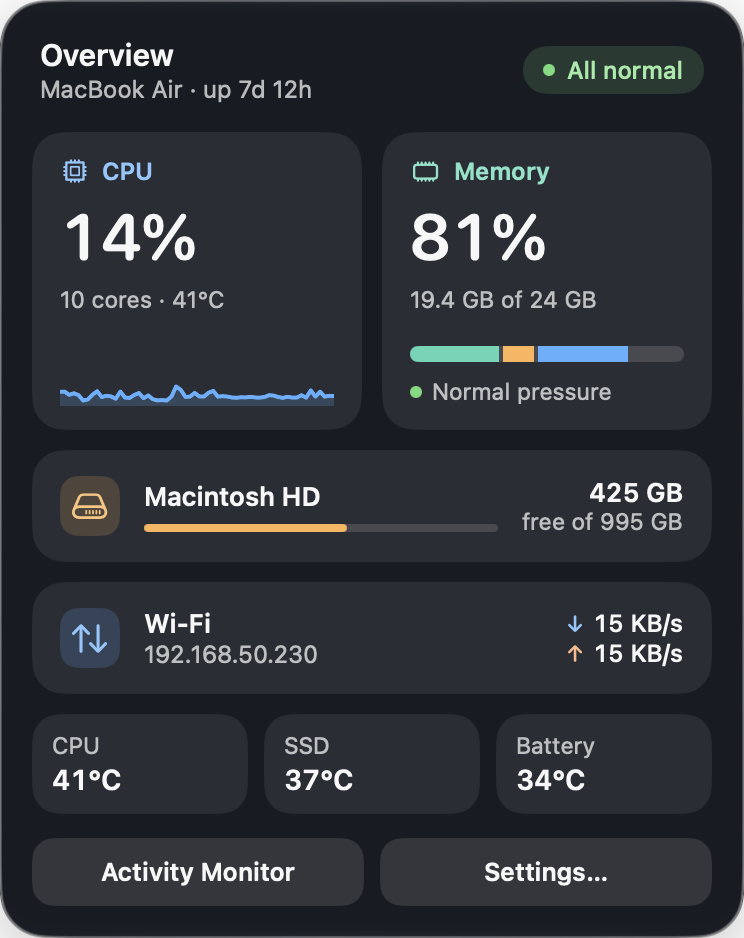
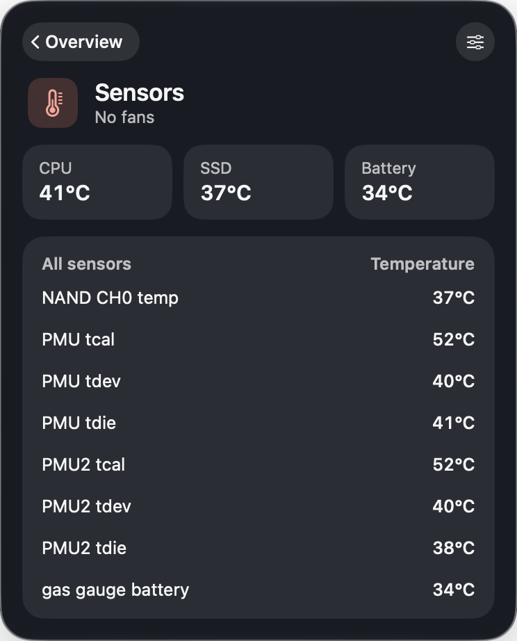
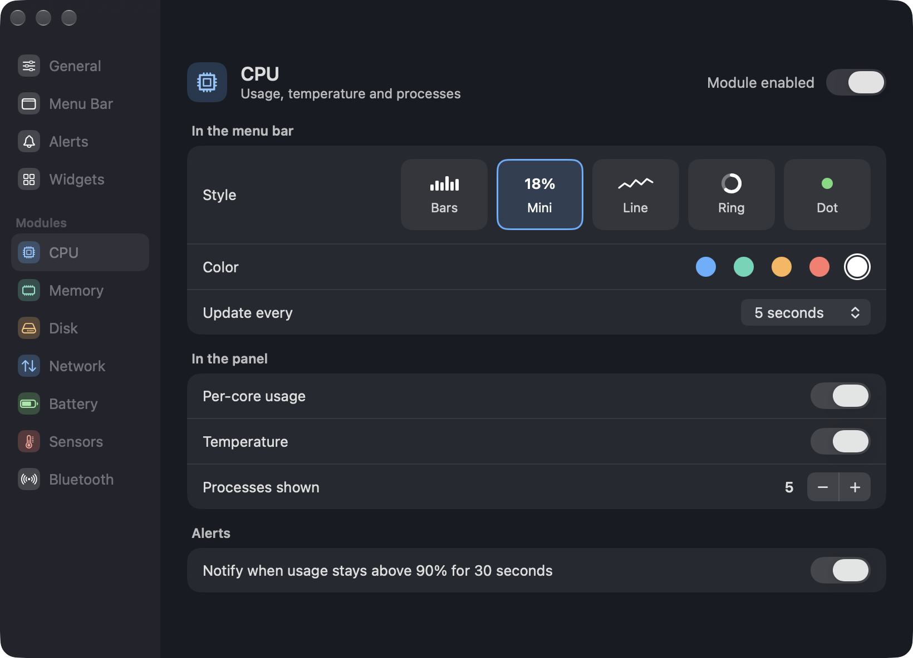

# Pulso

A menu bar system monitor for macOS. CPU, memory, disk, network, battery and sensors in a native glass panel that drops from the menu bar, with desktop widgets and alerts. Available in English and Portuguese (Brazil).

<p align="center">
  
  &nbsp;
  
</p>

<p align="center">
  <a href="https://github.com/oeduardoal/pulso/releases/latest"><b>Download the latest release</b></a>
  · macOS 26 or later · Apple Silicon and Intel
</p>

> **Status: 0.1.0, the first public version.** Every module, the settings window, alerts and the desktop widgets work. See [Roadmap](#roadmap) and [Known limitations](#known-limitations).

"Pulso" is a working title.

## Features

- **Menu bar widgets**: one per enabled module, in seven styles (mini, line, bars, ring, speed, battery, dot), monochrome by default.
- **Overview panel**: CPU, memory, disk, network, battery and sensor readings at a glance, with a status pill that names any active alert.
- **Module panels**: 60 second charts, per-core usage, memory pressure, per-volume space with eject, SMART state and wear, network rates with per-process traffic, battery health and Bluetooth device batteries, every temperature sensor and fan.
- **Desktop widgets**: small (CPU, memory) and medium (network).
- **Alerts**: notifications when a reading stays above a threshold.
- **Localized**: English and Portuguese (Brazil), with locale-aware numbers, units and dates.
- **Light on resources**: the monitor should not show up in its own process list.

## Settings

Pick which modules appear in the menu bar, in what order and in which style, and tune each module's panel and alerts.

<p align="center">
  
</p>

## Requirements

- macOS 26 or later
- Apple Silicon or Intel Mac

Pulso is distributed outside the Mac App Store, signed with Developer ID and notarized. Temperature and fan readings need access the App Sandbox does not allow.

## Install

1. Download `Pulso-x.y.z.dmg` from the [latest release](https://github.com/oeduardoal/pulso/releases/latest).
2. Open it and drag Pulso to Applications.
3. Open Pulso from Applications. It lives in the menu bar; there is no Dock icon.

Releases are signed with Developer ID and notarized by Apple, so they open without a security warning. Each release lists the DMG's SHA-256.

The design mockups the app was built from are in [`design/`](design/).

## Build from source

You need Xcode 26 or later and [XcodeGen](https://github.com/yonaskolb/XcodeGen). The Xcode project is generated from `project.yml` and is not checked in.

```sh
brew install xcodegen
xcodegen generate
open Pulso.xcodeproj
```

Signing uses the E-Dew team (`6HC4RKRHXD`) because the widget extension shares data with the app through an app group. To build with your own team, change `DEVELOPMENT_TEAM` in `project.yml` and the app group prefix in `Pulso/Shared/WidgetSnapshot.swift` and both `.entitlements` files. To build without signing at all (no widgets), add `CODE_SIGNING_ALLOWED=NO` to the `xcodebuild` command.

Or build from the command line:

```sh
xcodebuild -project Pulso.xcodeproj -scheme Pulso -configuration Debug -derivedDataPath build build
open build/Build/Products/Debug/Pulso.app
```

Run the tests with:

```sh
xcodebuild -project Pulso.xcodeproj -scheme Pulso -derivedDataPath build test
```

Pulso runs as a menu bar app with no Dock icon. Click the status item to open the panel. Right-click it for Settings and Quit. Widgets and launch at login work best from `/Applications`.

To run in Portuguese without changing the system language, pass `-AppleLanguages "(pt-BR)"` as a launch argument (Scheme > Run > Arguments in Xcode).

## Project layout

| Path | Contents |
| --- | --- |
| `Pulso/App` | Entry point, status item and settings window |
| `Pulso/Sampling` | One sampler per module, the `Monitor` that schedules them, and the alert engine |
| `Pulso/Hardware` | C helpers for readings with no Swift-friendly API: HID thermal sensors, SMC fans, NVMe SMART, GPU and disk I/O |
| `Pulso/Panel`, `Pulso/MenuBar`, `Pulso/Settings` | SwiftUI views for the panel, the menu bar widgets and the settings panes |
| `Pulso/Design`, `Pulso/Shared` | Theme values, shared components and charts; formatting, localization and preferences (shared with the widgets) |
| `PulsoWidgets/` | WidgetKit extension: CPU, memory and network desktop widgets |
| `PulsoTests/` | Unit tests |
| `localization/Localizable.xcstrings` | String Catalog for every user-facing string, English and Portuguese (Brazil) |
| `design/` | HTML mockups, screenshots and design tokens. The source of truth for layout, spacing and color |
| `brand/` | Brand kit: app icon, logo, menu bar glyph, palette, icon set and a ready-made Xcode asset catalog. Not wired into the app yet; see [`brand/README.md`](brand/README.md) |
| `project.yml` | XcodeGen spec for the Xcode project |
| `HANDOFF.md` | Product spec: screens, data sources, architecture and build order |
| `docs/RELEASING.md` | How to cut, sign and notarize a release |

## Roadmap

Milestones from [`HANDOFF.md`](HANDOFF.md#7-suggested-build-order):

- [x] 1. Project skeleton: agent app, status item, glass panel
- [x] 2. CPU and memory samplers, overview tiles, menu bar widgets
- [x] 3. CPU and memory panels with charts and process lists
- [x] 4. Disk, network and battery
- [x] 5. Settings window
- [x] 6. Localization pass and formatters
- [x] 7. Alerts and notifications
- [x] 8. Sensors
- [x] 9. Widget extension

## Known limitations

- Process lists only include processes owned by the current user. System daemons need a privileged helper to read, which Pulso does not ship.
- Per-process network traffic comes from `nettop`, since macOS has no public API for it. It runs only while the network panel is open.
- The Wi-Fi network name is not shown: reading it requires Location Services permission.
- Temperatures and fans use private interfaces (HID event system, SMC) that Apple may change in any macOS release.
- macOS decides when desktop widgets refresh, usually about once a minute.
- Low Power Mode is shown read-only; the switch opens Battery settings, since changing it needs administrator rights.
- The latency check opens a TCP connection to a configurable host (1.1.1.1 by default), and the opt-in public IP lookup calls api.ipify.org. Both run only while the network panel is open.

## Contributing

Contributions are welcome, including translations. Read [CONTRIBUTING.md](CONTRIBUTING.md) before opening a pull request. Everyone taking part is expected to follow the [Code of Conduct](CODE_OF_CONDUCT.md).

To report a security issue, follow [SECURITY.md](SECURITY.md) instead of opening a public issue.

## License

[MIT](LICENSE)
