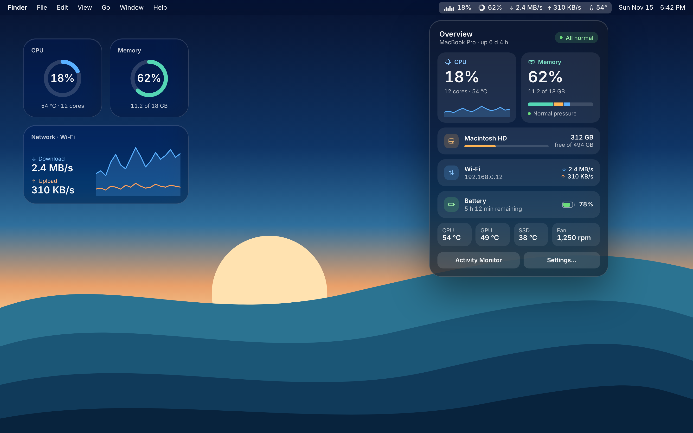

# Pulso

A menu bar system monitor for macOS. CPU, memory, disk, network, battery and sensors in a native glass panel that drops from the menu bar, with desktop widgets and alerts. Available in English and Portuguese (Brazil).



> **Status: early development.** The screenshot above is the design target, not the current build. The app skeleton (status item and glass panel) runs today; the monitors are being built milestone by milestone. See [Roadmap](#roadmap).

"Pulso" is a working title.

## Features

Planned for 1.0:

- **Menu bar widgets**: one per enabled module, in seven styles (mini, line, bars, ring, speed, battery, dot), monochrome by default.
- **Overview panel**: CPU, memory, disk, network, battery and sensor readings at a glance, with a status pill that names any active alert.
- **Module panels**: 60 second charts, per-core usage, memory pressure, per-volume space, network rates, battery health and top processes.
- **Desktop widgets**: small (CPU, memory) and medium (network).
- **Alerts**: notifications when a reading stays above a threshold.
- **Localized**: English and Portuguese (Brazil), with locale-aware numbers, units and dates.
- **Light on resources**: the monitor should not show up in its own process list.

## Requirements

- macOS 26 or later
- Apple Silicon or Intel Mac

Pulso is distributed outside the Mac App Store, signed with Developer ID and notarized. Temperature and fan readings need access the App Sandbox does not allow.

## Install

There are no releases yet. Once 0.1.0 ships, download the latest notarized build from the Releases page of this repository.

## Build from source

You need Xcode 26 or later and [XcodeGen](https://github.com/yonaskolb/XcodeGen). The Xcode project is generated from `project.yml` and is not checked in.

```sh
brew install xcodegen
xcodegen generate
open Pulso.xcodeproj
```

Or build from the command line:

```sh
xcodebuild -project Pulso.xcodeproj -scheme Pulso -configuration Debug -derivedDataPath build build
open build/Build/Products/Debug/Pulso.app
```

Pulso runs as a menu bar app with no Dock icon. Click the status item to open the panel. Right-click it to quit.

To run in Portuguese without changing the system language, pass `-AppleLanguages "(pt-BR)"` as a launch argument (Scheme > Run > Arguments in Xcode).

## Project layout

| Path | Contents |
| --- | --- |
| `Pulso/` | App source: `App` (entry point, status item), `Panel` (panel window and views), `Settings`, `Design` (theme values) |
| `localization/Localizable.xcstrings` | String Catalog for every user-facing string, English and Portuguese (Brazil) |
| `design/` | HTML mockups, screenshots and design tokens. The source of truth for layout, spacing and color |
| `project.yml` | XcodeGen spec for the Xcode project |
| `HANDOFF.md` | Product spec: screens, data sources, architecture and build order |
| `docs/RELEASING.md` | How to cut, sign and notarize a release |

## Roadmap

Milestones from [`HANDOFF.md`](HANDOFF.md#7-suggested-build-order):

- [x] 1. Project skeleton: agent app, status item, glass panel
- [ ] 2. CPU and memory samplers, overview tiles, menu bar widgets
- [ ] 3. CPU and memory panels with charts and process lists
- [ ] 4. Disk, network and battery
- [ ] 5. Settings window
- [ ] 6. Localization pass and formatters
- [ ] 7. Alerts and notifications
- [ ] 8. Sensors
- [ ] 9. Widget extension

## Contributing

Contributions are welcome, including translations. Read [CONTRIBUTING.md](CONTRIBUTING.md) before opening a pull request. Everyone taking part is expected to follow the [Code of Conduct](CODE_OF_CONDUCT.md).

To report a security issue, follow [SECURITY.md](SECURITY.md) instead of opening a public issue.

## License

[MIT](LICENSE)
